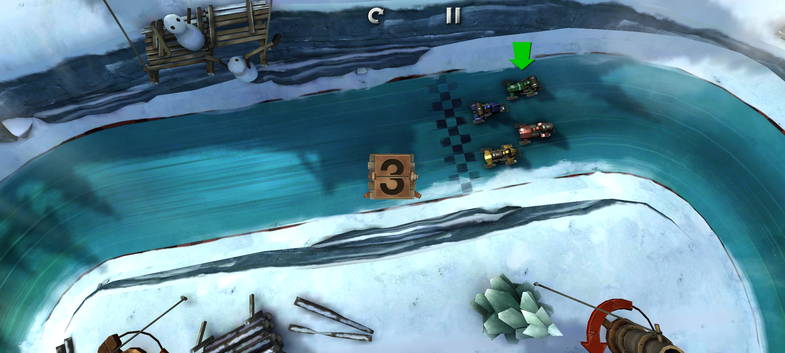
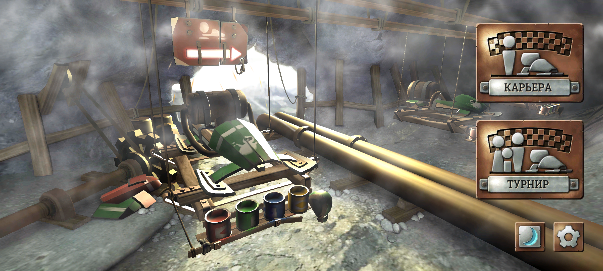

# Slingshot Racing Remastered

An unofficial port of **Slingshot Racing** whose purpose is to **preserve gaming heritage and keep the game playable on modern phones**. The original Android game is restored in Unity 6 with ARM64 support, Russian localization, and an interface that adapts to wide and foldable screens.



**Unity 6000.3.25f1 · Android ARM64 · IL2CPP · OpenGL ES 3 · Version 1.4.0.0**

The goal is to carry the original game's design, atmosphere, and local multiplayer forward as mobile platforms change. Compatibility work preserves its identity while making it usable on current hardware.

This is a private development and preservation repository. It contains recovered game material as well as porting work; it is not an official release or a blanket open-source distribution. Original credits and ownership are preserved. See [Credits](CREDITS.md), [Rights and licensing](LICENSE.md), and [Third-party notices](THIRD_PARTY_NOTICES.md).

## The original game

Slingshot Racing is a steampunk arcade racer developed by **Snowbolt Interactive Ltd.** and published by **[Crescent Moon Games](https://www.crescentmoongames.com/)**. Instead of steering, players hold the screen to hook an anchor and release to swing out of a corner. Its icy tracks combine races, time trials, cog collection, and the pursuing Chomper. Up to four players can share one device.

The original launched on iPhone and iPad on **May 24, 2012**, followed by Android on **February 26, 2013**. Sources: the publisher's [official launch trailer](https://www.youtube.com/watch?v=T2YFg4pHar0), the [release record](https://www.mobygames.com/game/100208/slingshot-racing/releases/), and the original in-game credits preserved in this tree. Snowbolt's historical website is no longer an active studio site; its [company record](https://www.mobygames.com/company/31070/snowbolt-interactive-ltd/) is linked for attribution.

## What this restoration changes

- Migrates the Android 1.3.3.3 / Unity 3.5.7f6 baseline to **Unity 6.3 LTS 6000.3.25f1**.
- Reconstructs the native numerical plugin in C++ for **Android ARM64** and the **macOS Apple Silicon editor**, with 16 KB Android page alignment.
- Restores shaders, legacy particles, lightmaps, UI behavior, and track handling across the engine upgrade.
- Keeps career progression, local saves, race replays, and same-device multiplayer.
- Adds Russian alongside English, French, Italian, German, and Spanish, including Cyrillic font glyphs.
- Adapts menus, safe areas, and touch regions to wide screens and fold/unfold transitions.

Legacy accounts, cloud saves, platform leaderboards, purchases, social sharing, analytics, and Kamcord are not connected in this offline port. They are documented individually in [Online services](docs/ONLINE_SERVICES.md).

<details>
<summary>Russian interface</summary>



Choose **English → Русский** in Settings to change language. The selection is saved; a fresh installation uses Russian automatically when Android's system language is Russian.

</details>

## Build and run

The supplied build scripts target **macOS on Apple Silicon**. Install Unity **6000.3.25f1** with Android Build Support, Android SDK & NDK Tools, and OpenJDK; activate the editor and install Xcode Command Line Tools.

From the repository root:

```sh
python3 scripts/build_native.py
scripts/build_android.sh
```

The release build is written to `builds/SlingshotRacing-modern-arm64.apk`. A development build is available with:

```sh
scripts/build_android.sh development
```

For editor play, first build the native plugin, open `unity/` in Unity Hub, and choose **Slingshot → Play restored game**. **Slingshot → Build modern Android APK** builds the release from the editor.

`SLINGSHOT_UNITY` selects the Unity executable; `SLINGSHOT_NDK` selects the Android NDK directory. Generated native libraries, APKs, Unity caches, and signing keys are excluded from Git. The editable assets and recovery reference required by the resource checks are included; the original APK is not needed for a normal build.

See [Building and verification](docs/BUILDING.md) for Python dependencies, optional recovery tools, and the original inputs required by the native parity test.

## Android compatibility

| Setting | Value |
|---|---|
| Minimum Android | Android 8.0 / API 26 |
| Target SDK | API 36 |
| Architecture | ARM64 only |
| Rendering | OpenGL ES 3, Gamma |
| Orientation | Both landscape orientations |
| Application ID | `com.crescentmoongames.slingshotracing.modern` |
| Application version | `1.4.0.0`, versionCode `15` |
| Signing | Local debug signing; no publisher signing key |

```sh
adb install -r builds/SlingshotRacing-modern-arm64.apk
```

The application installs separately from the original and has its own save data. This repository does not publish APK downloads or store signing credentials.

## Validation status

The existing porting record reports 3,400 native numerical comparisons, resource/GUID checks, 268 localization keys, Android 16/17 testing, 16 KB alignment checks, and a 128-assertion resize/input regression. A selected 39-scenario track catalogue was covered through a full run and targeted reruns; it was not one uninterrupted 39/39 run on the final APK.

The final 1.4.0.0 APK was installed on a Samsung SM-F976B, and the owner confirmed the fold/unfold fix. A full physical-device campaign and a side-by-side playthrough against the original on an old Android device remain unverified. Numerical parity does not establish identical behavior between the old and new PhysX versions.

These are recorded results from the porting work, not a claim that every scenario is rerun on each commit. [QA](docs/QA.md) distinguishes builds, evidence, and remaining limits; raw captures and device logs remain local under the ignored `work/` directory.

## Repository layout

| Directory | Purpose |
|---|---|
| `unity/Assets`, `Packages`, `ProjectSettings` | Editable modern Unity project and package lock |
| `native/` | Reconstructed `GrappleRacerNative` C++ implementation |
| `recovered/ExportedProject/` | Unmodified recovery baseline for comparison and audits |
| `recovered/OriginalShaders/` | Original shader programs used during restoration |
| `scripts/` | Build, restoration, localization, and APK checks |
| `tests/` | Native parity harness and its ABI fixtures |
| `third_party/roboto-slab/` | Font source, provenance, and Apache 2.0 license |
| `docs/` | English engineering notes and selected screenshots |
| `work/`, `builds/` | Local inputs, diagnostics, and outputs; not versioned |

[Porting notes](docs/PORTING.md) · [Foldable screens](docs/FOLDABLES.md) · [Localization](docs/LOCALIZATION.md) · [Online services](docs/ONLINE_SERVICES.md) · [Contributing](CONTRIBUTING.md)

## Credits and rights

The original game credits state **Copyright © 2012 Snowbolt Interactive Ltd. All rights reserved.** Publishing credit belongs to Crescent Moon Games. Game music is credited to Andrew J Goose; theme music to [Sean Beeson](https://www.seanbeeson.com/); sound design to Jerry Leeper. The [complete attribution record](CREDITS.md) preserves the development team and supporting credits.

“Remastered” describes this independent restoration. Snowbolt Interactive, Crescent Moon Games, and the original contributors have not endorsed this repository. Their names, game assets, music, and recovered code are not relicensed by the port. Third-party components retain their own terms.
